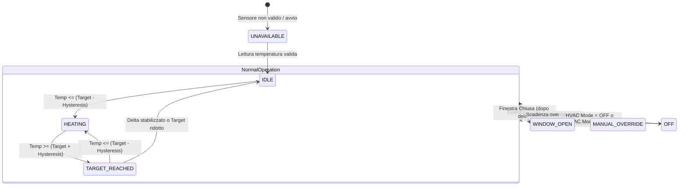
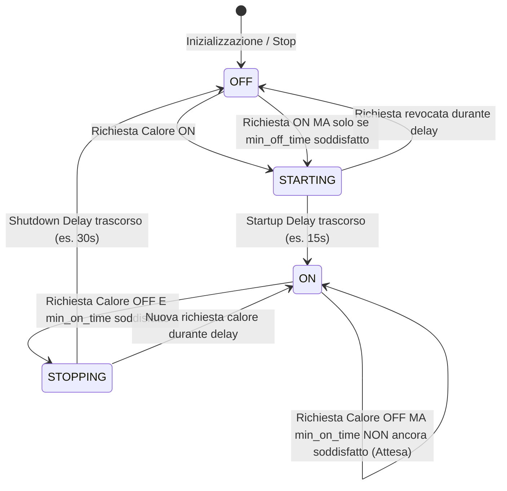
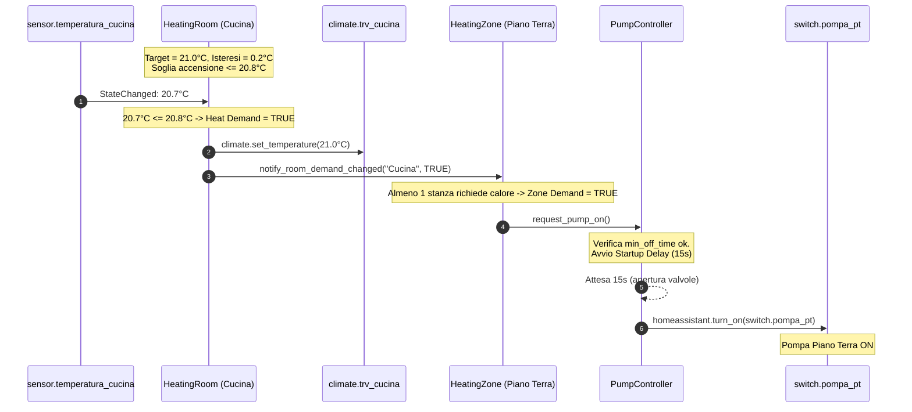
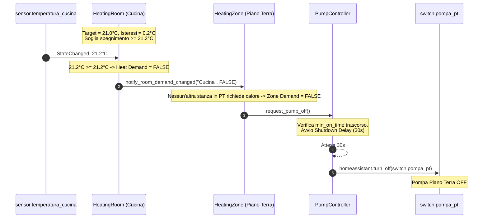
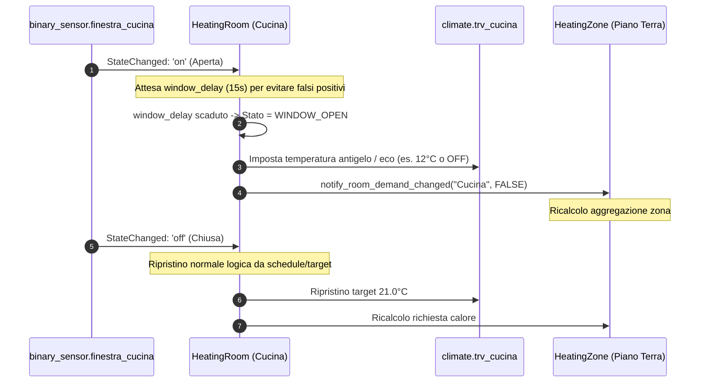

# Documento di Progettazione Architetturale: Zoned Heating Thermostat

**Integrazione Custom Nativa per Home Assistant**  
*Autore: Antigravity Core Architecture Team*  
*Versione: 1.0.0-DRAFT*  
*Target Home Assistant: >= 2024.6.0 (compatibile 2024.x, 2025.x, 2026.x)*

---

## 1. Visione del Progetto e Principi Guida

L'obiettivo è la realizzazione di una **Custom Integration di primo livello (Hub nativo)** per Home Assistant, progettata specificamente per impianti a biomassa/puffer a zone (es. Piano Terra e Piano Primo con pompe indipendenti e radiatori con TRV Zigbee).

### Principi Guida Fondamentali
1. **Pipeline Unidirezionale e Disaccoppiamento Rigido**:
   $$\text{Schedule} \longrightarrow \text{Target} \longrightarrow (\text{Target} + \text{Temp} \rightarrow \text{Room Demand}) \longrightarrow \text{Zone Demand} \longrightarrow \text{Pump}$$
   Nessun componente a valle conosce la logica del componente a monte:
   - La pompa **non conosce** lo scheduler né le stanze: risponde esclusivamente allo stato della Zona e ai propri timer di sicurezza (anti short-cycle).
   - La Zona aggrega puramente le richieste (OR logico) delle stanze.
   - La Stanza determina la richiesta di calore in base alla temperatura locale, al target calcolato e all'isteresi configurata.
   - Le TRV sono attuatori locali che riflettono il target della stanza (e opzionalmente la modalità), senza che la loro apertura fisica piloti direttamente la pompa.
2. **Zero-YAML e Zero-Helper**:
   Nessuna necessità di configurare file `configuration.yaml`, automazioni, script, `input_number`, `input_select` o template sensor. Tutta la configurazione, la persistenza e le logiche risiedono all'interno dell'integrazione.
3. **Pannello Dedicato Full-Width (Non solo card)**:
   Registrazione di un Custom Panel nativo nella sidebar di Home Assistant (`/zoned-thermostat`), responsive per desktop (wide-screen moderno con sezioni affiancate), tablet e mobile, integrato con i token CSS del tema di Home Assistant.
4. **Resilienza e Fail-Safe Fisico**:
   L'impianto governa calore ed energia reali. Dopo un riavvio di Home Assistant o in caso di perdita di segnale Zigbee/sensore, il sistema non si affida a stati stale o memorie volatili: esegue un ricalcolo deterministico a freddo con fallback sicuri (safe-off).
5. **Tracciabilità Diagnostica**:
   Ogni accensione o spegnimento della pompa e ogni variazione di richiesta di calore è accompagnata dalla motivazione causale esplicita e salvata in un event log circolare.

---

## 2. Architettura del Software e Layering

L'integrazione è strutturata secondo una rigorosa architettura a livelli (Clean Architecture / Hexagonal Architecture):

```
+-----------------------------------------------------------------------+
|                           PRESENTATION LAYER                          |
|  +-----------------------------+  +--------------------------------+  |
|  | Dedicated Full-Width Panel  |  | Standard HA Entities           |  |
|  | (Lit / Web Components UI)   |  | (Climate, BinarySensor, Sensor)|  |
|  +--------------+--------------+  +---------------+----------------+  |
|                 | (WebSocket API)                 |                   |
+-----------------|---------------------------------|-------------------+
                  v                                 v
+-----------------------------------------------------------------------+
|                          INTEGRATION LAYER (HA)                       |
|  +-----------------------------+  +--------------------------------+  |
|  | Config / Options Flow       |  | State Listeners & Event Bus    |  |
|  +-----------------------------+  +--------------------------------+  |
|  | HA Storage Provider (Store) |  | HA Service & Repair Handlers   |  |
|  +-----------------------------+  +--------------------------------+  |
+-----------------------------------------------------------------------+
                                  |
                                  v
+-----------------------------------------------------------------------+
|                            DOMAIN CORE                                |
|  +-----------------------------------------------------------------+  |
|  |                          HeatingSystem                          |  |
|  |   - Global Mode (Home, Away, Frost, Off, Vacation)              |  |
|  |   - Diagnostic Event Log Buffer (Ring Buffer N events)          |  |
|  |   - Safety & Health Supervisor                                  |  |
|  +-----------------------------------------------------------------+  |
|               |                                                       |
|               v                                                       |
|  +-----------------------------------------------------------------+  |
|  |                           HeatingZone                           |  |
|  |   - Zone Heat Demand Aggregator (OR logic)                      |  |
|  |   - Pump Controller (Anti Short-Cycle State Machine)            |  |
|  +-----------------------------------------------------------------+  |
|               |                                                       |
|               v                                                       |
|  +-----------------------------------------------------------------+  |
|  |                           HeatingRoom                           |  |
|  |   - Temperature Sensor Aggregator (Primary, Secondary, Median)  |  |
|  |   - Target Resolver (Schedule + Presets + Manual Overrides)     |  |
|  |   - Room Demand Calculator (Configurable Asymmetric Hysteresis) |  |
|  |   - TRV Controller (Multi-TRV Target & Mode Dispatcher)         |  |
|  |   - Window & Presence Interlocks                                |  |
|  +-----------------------------------------------------------------+  |
+-----------------------------------------------------------------------+
```

### Regola di Dipendenza
Il **Domain Core** (`core/`) è completamente agnostico rispetto al framework di rendering di Home Assistant: non eredita da classi di entità HA (`CoordinatorEntity`, `ClimateEntity`). Riceve dati primitivi e notifiche di stato e pubblica eventi di dominio. Questo consente test unitari fulminei e isolati al 100% senza dover mockare l'intero runtime di Home Assistant.

---

## 3. Domain Model

### 3.1 Classi di Dominio Fondamentali

#### `HeatingSystem`
- `id`: string (UUID)
- `name`: string (es. "Riscaldamento Casa")
- `global_mode`: Enum (`HOME`, `AWAY`, `FROST`, `OFF`, `VACATION`)
- `zones`: `Dict[str, HeatingZone]`
- `event_log`: `EventLogBuffer` (mantiene gli ultimi $N=100$ eventi con timestamp, entità, vecchio stato, nuovo stato e motivazione)
- `presets`: `Dict[str, float]` (es. `COMFORT`: 21.0, `ECO`: 18.0, `SLEEP`: 17.0, `AWAY`: 16.0, `FROST`: 10.0)

#### `HeatingZone`
- `id`: string (slug)
- `name`: string (es. "Piano Terra")
- `rooms`: `Dict[str, HeatingRoom]`
- `pump_controller`: `PumpController`
- `heat_demand`: bool
- `state`: Enum (`IDLE`, `HEATING`, `OFF`, `UNAVAILABLE`)
- `demand_source_rooms`: `List[str]` (elenco delle stanze che in questo istante causano la domanda di calore)

#### `HeatingRoom`
- `id`: string (slug)
- `name`: string (es. "Cucina")
- `zone_id`: string
- `temp_sensor_ids`: `List[str]` (primario + opzionali secondari)
- `temp_aggregation`: Enum (`PRIMARY_ONLY`, `AVERAGE`, `MINIMUM`, `MAXIMUM`)
- `trv_ids`: `List[str]`
- `window_sensor_id`: Optional[str]
- `window_delay_seconds`: int (default: 15s prima di sospendere il riscaldamento)
- `presence_sensor_id`: Optional[str]
- `min_temp`: float (default 10.0°C)
- `max_temp`: float (default 28.0°C)
- `hysteresis`: float (default 0.2°C, con soglie $T_{on} = T_{target} - \Delta_{hyst}$ e $T_{off} = T_{target} + \Delta_{hyst}$)
- `current_temp`: Optional[float]
- `target_temp`: float
- `active_preset`: Optional[str]
- `heat_demand`: bool
- `state`: Enum (`IDLE`, `HEATING`, `TARGET_REACHED`, `OFF`, `AWAY`, `FROST`, `WINDOW_OPEN`, `UNAVAILABLE`, `MANUAL_OVERRIDE`)
- `schedule`: `RoomSchedule`
- `manual_override`: Optional[ManualOverride]

#### `PumpController`
- `pump_switch_id`: string (es. `switch.pompa_pt`)
- `min_on_time_seconds`: int (default: 120s)
- `min_off_time_seconds`: int (default: 120s)
- `startup_delay_seconds`: int (default: 15s)
- `shutdown_delay_seconds`: int (default: 30s)
- `current_physical_state`: bool (ON/OFF letto da HA)
- `logical_state`: Enum (`OFF`, `STARTING`, `ON`, `STOPPING`, `UNAVAILABLE`)
- `last_switch_on_timestamp`: Optional[float]
- `last_switch_off_timestamp`: Optional[float]
- `pending_timer`: Optional[asyncio.TimerHandle]

---

## 4. Entity Model per Home Assistant

L'integrazione registra un dispositivo radice `HeatingSystem` e sotto-dispositivi per ciascuna `Zone` e ciascuna `Room` tramite il **Device Registry** di Home Assistant (`DeviceEntry`), creando una gerarchia chiara e visibile anche nelle impostazioni standard di HA.

```
Device: [System] Riscaldamento
  ├── Sensor: System Mode (sensor.riscaldamento_mode)
  ├── Sensor: Total Active Zones (sensor.riscaldamento_active_zones)
  ├── Sensor: Total Heat Demand (binary_sensor.riscaldamento_heat_demand)
  │
  ├── Device: [Zone] Piano Terra (via_device: System)
  │     ├── Binary Sensor: Zone Heat Demand (binary_sensor.piano_terra_heat_demand)
  │     ├── Sensor: Zone Status (sensor.piano_terra_status)
  │     ├── Sensor: Zone Active Rooms (sensor.piano_terra_active_rooms)
  │     └── Sensor: Pump Status (sensor.piano_terra_pump_status)
  │
  └── Device: [Room] Cucina (via_device: Zone Piano Terra)
        ├── Climate: Cucina Thermostat (climate.riscaldamento_cucina)
        ├── Binary Sensor: Room Heat Demand (binary_sensor.cucina_heat_demand)
        ├── Sensor: Room Current Temperature (sensor.cucina_current_temperature)
        ├── Sensor: Room Target Temperature (sensor.cucina_target_temperature)
        └── Sensor: Room Operating Status (sensor.cucina_status)
```

### Caratteristiche della `ClimateEntity` di Stanza
- Rappresenta il **termostato logico di stanza** (non coincide banalmente con la singola TRV).
- `supported_features`: `ClimateEntityFeature.TARGET_TEMPERATURE | ClimateEntityFeature.PRESET_MODE | ClimateEntityFeature.TURN_ON | ClimateEntityFeature.TURN_OFF`.
- `hvac_modes`: `[HVACMode.HEAT, HVACMode.OFF]`.
- `preset_modes`: `["none", "comfort", "eco", "sleep", "away", "frost"]`.
- Comandabile direttamente da Lovelace standard, Google Assistant / Alexa / Assist e automazioni utente. Qualsiasi modifica da `climate.set_temperature` attiva un **Manual Override** con scadenza configurabile.

---

## 5. State Machine Deterministiche

### 5.1 Room State Machine



#### Condizione Deterministica di Calore della Stanza
Dato un target $T_{target}$ e un'isteresi configurata $\Delta_{hyst} = 0.2^\circ\text{C}$:
- Se $\text{window\_open} == \text{True} \implies \text{Demand} = \text{False}$ (Stato: `WINDOW_OPEN`)
- Se $\text{hvac\_mode} == \text{OFF} \text{ o } \text{global\_mode} == \text{OFF} \implies \text{Demand} = \text{False}$ (Stato: `OFF`)
- Se $T_{current}$ non disponibile $\implies \text{Demand} = \text{False}$ (Stato: `UNAVAILABLE`, Fail-Safe)
- Se precedentemente $\text{Demand} == \text{False}$:
  - $\text{Demand}$ diventa $\text{True}$ se e solo se $T_{current} \le (T_{target} - \Delta_{hyst})$
- Se precedentemente $\text{Demand} == \text{True}$:
  - $\text{Demand}$ diventa $\text{False}$ se e solo se $T_{current} \ge (T_{target} + \Delta_{hyst})$

### 5.2 Zone State Machine
$$\text{ZoneDemand} = \bigvee_{r \in \text{Rooms}_{\text{Zone}}} \text{RoomDemand}_r$$
- Se $\text{ZoneDemand} == \text{True} \implies$ Zona in stato `HEATING`, inoltro ordine di attivazione al `PumpController`.
- Se $\text{ZoneDemand} == \text{False} \implies$ Zona in stato `IDLE`, inoltro ordine di disattivazione al `PumpController`.

### 5.3 Pump Controller State Machine (Anti Short-Cycle)



#### Regole Rigorose per la Pompa:
1. **Min ON Time** (default: 120s): Una volta che la pompa è fisicamente accesa, non può essere spenta prima di 120s, a meno di spegnimento d'emergenza o stop manuale forzato.
2. **Min OFF Time** (default: 120s): Dopo che la pompa si spegne, deve rimanere spenta per almeno 120s prima di potersi riaccendere, proteggendo il rotore da picchi e usura.
3. **Startup Delay** (default: 15s): Quando una stanza richiede calore, attendiamo che le TRV Zigbee ricevano il comando e inizino a traslare i pistoncini prima di avviare il circolatore, prevenendo cavitazione o colpi di pressione su circuiti completamente chiusi.
4. **Shutdown Delay** (default: 30s): Circolazione post-riscaldamento (dissipazione inerzia termica del radiatore).

---

## 6. Scheduler e Modello di Override

### 6.1 Struttura della Fascia Oraria (Time Block)
Ogni stanza possiede un `RoomSchedule` settimanale composto da 7 giorni (`mon`, `tue`, `wed`, `thu`, `fri`, `sat`, `sun`).
Ogni giorno contiene una lista ordinata di intervalli non sovrapposti:
```json
{
  "start": "06:30",
  "end": "08:30",
  "preset": "comfort",
  "target_temp": 21.0
}
```
Se `preset` è valorizzato (es. `"comfort"`), il target effettivo è legato al valore del preset configurato a livello globale/stanza. Se l'utente aggiorna il preset "Comfort" da $21^\circ\text{C}$ a $21.5^\circ\text{C}$, tutte le fasce che usano `"comfort"` ereditano istantaneamente la modifica senza dover ricreare lo schedule!

### 6.2 Motore di Risoluzione del Target a Tempo Determinato
A ogni minuto o a ogni variazione di stato, il `TargetResolver` valuta:
1. Esiste un **Manual Override** attivo?
   - Se sì, verifica condizione di scadenza:
     - `UNTIL_NEXT_BLOCK`: scade non appena l'orologio supera l'estremo `end` del blocco schedule corrente.
     - `TIMER`: scade dopo $X$ minuti configurati (es. 60 min, 120 min).
     - `INDEFINITE`: resta attivo fino a esplicita cancellazione da UI.
   - Se scaduto, viene rimosso automaticamente e ripristinato il target da schedule.
   - Se valido, ha priorità sul programma.
2. Se non c'è override:
   - Trova il blocco corrente del giorno attuale.
   - Restituisce il `target_temp` del blocco (o del preset associato).
   - Se non esiste alcun blocco coperto (buco di schedule) $\implies$ fallback su preset `ECO` (o valore di sicurezza $18.0^\circ\text{C}$).

### 6.3 Motore di Clonazione (Copy Engine)
Operazioni esposte via WebSocket/Service:
- `copy_day(from_day, to_day, room_id)`
- `copy_to_week(from_day, room_id)`
- `copy_room_schedule(from_room_id, to_room_id)`
- `copy_zone_schedule(from_zone_id, to_zone_id)`

---

## 7. Persistenza e Riavvio di Home Assistant

### 7.1 Home Assistant Storage API (`helpers.storage.Store`)
- File memorizzato in `.storage/zoned_thermostat.storage`:
  - `version`: 1
  - `key`: `"zoned_thermostat"`
  - `data`:
    - `system_config`: impostazioni globali, modalità, preset.
    - `zones`: dizionario zone, parametri pompe, associazioni stanze.
    - `rooms`: parametri termici, isteresi, sensori, TRV, schedule settimanali, override attivi con timestamp assoluto di scadenza.
- Salvataggio asincrono con debouncing (`store.async_delay_save`) per evitare scritture su disco a ogni minimo tick.

### 7.2 Boot & Recovery Deterministic Sequence
All'avvio di Home Assistant:
1. Caricamento schema da Storage.
2. Registrazione entità nei registri HA (Device & Entity Registry).
3. Recupero letture sensori da `hass.states.get(...)`.
4. Ricalcolo target di ogni stanza in base all'orario UTC corrente e allo schedule.
5. Calcolo deterministico di $T_{on} / T_{off}$ per ogni stanza.
6. Aggregazione zone.
7. **Allineamento Pompa Fisico**: La pompa viene comandata in base alla situazione reale calcolata, azzerando qualsiasi presunzione sullo stato precedente al reboot.

---

## 8. Architettura Frontend: Dedicated Full-Width Panel

Il requisito richiede una **vera pagina/schermata dedicata**, moderna, ampia e chiara, non compressa in una singola card.

### 8.1 Registrazione del Pannello
- Utilizzo dell'API nativa di Home Assistant:
  ```python
  hass.components.frontend.async_register_built_in_panel(
      component_name="custom",
      sidebar_title="Riscaldamento",
      sidebar_icon="mdi:home-thermometer-outline",
      frontend_url_path="zoned-thermostat",
      config={
          "_panel_type": "zoned-thermostat-panel",
          "module_url": "/zoned_thermostat_static/zoned-thermostat-panel.js"
      },
      require_admin=False
  )
  ```
- Servito come risorsa statica via `hass.http.register_static_path`.

### 8.2 Componenti UI del Pannello (Modern Lit / Custom Web Components)
1. **Header & Global Status Bar**:
   - Badge modalità globale attiva (`Home`, `Away`, `Frost`, `Off`).
   - Selettore rapido preset globale.
   - Temperatura media complessiva e conteggio zone/stanze in riscaldamento.
2. **Sezione Zone (Grid / Split View ad alta leggibilità)**:
   - Card ampia per ciascuna Zona (Piano Terra, Piano Primo).
   - Indicatore di stato pompa (Badge dinamico ON con animazione fiamma/circolatore o OFF).
   - Motivazione esplicita in tempo reale: *"Pompa ON: richiesta da Cucina (20.1°C / target 21.0°C)"*.
   - Griglia stanze appartenenti alla zona.
3. **Room Card Dettagliata**:
   - Termometro ad arco / Slider moderno per regolazione intuitiva.
   - Indicatore grafico del delta ($T_{current}$ vs $T_{target}$).
   - Badge di stato semantico:
     - 🔥 `IN RISCALDAMENTO` (arancione caldo)
     - ✓ `TARGET RAGGIUNTO` (verde eco)
     - ⏸ `FINESTRA APERTA` (azzurro warning)
     - ⏱ `OVERRIDE ATTIVO` (viola chiaro con countdown)
   - Lista TRV con relativa percentuale di apertura (se esposta dal dispositivo Zigbee) o stato sincronizzato.
4. **Visual Weekly Scheduler (Calendario Settimanale Interattivo)**:
   - Visualizzazione a fasce orarie tipo planner per giorno (Lun-Dom).
   - Blocchi colorati in base al preset (Comfort = Arancione, Eco = Blu chiaro, Sleep = Indaco).
   - Click su un blocco per editare o trascinare orari.
   - Barra azioni rapide: *"Copia su Martedì"*, *"Copia sull'intera settimana"*, *"Applica a tutta la Zona"*.
5. **Timeline Diagnostica in Tempo Reale**:
   - Feed cronologico scrollabile con icone semantiche:
     - `22:01 🔥 Cucina: richiesta calore (20.4°C <= 20.8°C)`
     - `22:01 ⚡ Piano Terra: richiesta calore attiva`
     - `22:01 ▶ Pompa PT: avviata (dopo 15s startup delay)`
     - `22:14 ✓ Cucina: target raggiunto (21.2°C >= 21.2°C)`
     - `22:14 ⏹ Pompa PT: spenta`

### 8.3 Canale di Comunicazione: WebSocket API Nativa
Endpoint dedicati WebSocket per garantire massima reattività senza overhead HTTP REST:
- `zoned_thermostat/get_overview`: Restituisce l'albero completo (System -> Zone -> Room -> Pompe -> TRV -> Override).
- `zoned_thermostat/subscribe_updates`: Event stream reattivo in tempo reale.
- `zoned_thermostat/set_room_override`: `{room_id, target, mode, duration_minutes}`.
- `zoned_thermostat/update_schedule`: `{room_id, schedule_data}`.
- `zoned_thermostat/copy_schedule`: `{source_id, target_id, scope}`.
- `zoned_thermostat/set_global_mode`: `{mode}`.
- `zoned_thermostat/get_diagnostics_events`: `{limit: 50}`.

---

## 9. Config Flow & Options Flow Guidato

### 9.1 Wizard Iniziale Step-by-Step (Config Flow)
```
Step 1: Benvenuto & Nome Impianto
   └── Input: Nome (es. "Riscaldamento Casa")
        ↓
Step 2: Definizione delle Zone
   └── Input: Quante e quali zone (es. "Piano Terra", "Piano Primo")
        ↓
Step 3: Definizione delle Stanze per Zona
   └── Loop dinamico per ogni zona creata:
       Aggiunta stanze (Nome, es. Sala, Cucina, Bunker per PT)
        ↓
Step 4: Associazione Sensori e TRV (con Autodiscovery intelligente)
   └── Per ogni stanza:
       - Menu a tendina per Primary Temperature Sensor (filtrato su sensor.*temperature*)
       - Multi-select per TRVs (filtrato su climate.* con suggerimento basato su match nome)
       - Opzionale: Sensore Finestra (binary_sensor.*)
        ↓
Step 5: Associazione Pompe di Zona
   └── Per ogni zona:
       - Selettore switch.* per la pompa (es. switch.pompa_pt, switch.pompa_p1)
        ↓
Step 6: Parametri Base e Preset di default
   └── Valori di default preimpostati (Comfort 21°, Eco 18°, Isteresi 0.2°, Min ON/OFF 120s)
        ↓
Step 7: Riepilogo & Conferma Creazione Impianto
```

### 9.2 Autodiscovery Intelligente
L'integrazione effettua una scansione non invasiva di `hass.states`:
- Cerca entità `climate.*` escludendo quelle dell'integrazione stessa.
- Se una stanza si chiama "Cucina", pre-seleziona o suggerisce `sensor.temperatura_cucina` o `climate.trv_cucina`.
- L'utente ha sempre il controllo finale prima del salvataggio.

### 9.3 Options Flow (Modifica Continua)
Tutti i parametri (aggiunta nuova stanza, cambio sensore, modifica tempi anti short-cycle, modifica isteresi avanzata) sono modificabili sia via **Options Flow standard di HA** che direttamente dalla UI del pannello dedicato.

---

## 10. Diagrammi di Sequenza

### 10.1 Ciclo Normale di Richiesta Calore con Isteresi e Delay



### 10.2 Spegnimento con Raggiungimento Soglia Superiore



### 10.3 Interblocco Finestra Aperta



---

## 11. Gestione Errori, Resilienza e Fail-Safe

| Scenario di Errore | Comportamento del Sistema | Notifica / Diagnostica |
| :--- | :--- | :--- |
| **Sensore Temperatura `unavailable` / `unknown`** | La stanza entra in stato `UNAVAILABLE`. La richiesta di calore della stanza viene forzata a **FALSE** (Fail-Safe: evita che una stanza scaldi all'infinito a causa di una lettura congelata). | Evento nel log diagnostico, badge di errore nella UI, registrazione di una notifica di riparazione se persiste per oltre 30 minuti. |
| **TRV Zigbee `unavailable`** | Il target della stanza continua a essere calcolato. Non appena la TRV torna `online`, viene risincronizzato immediatamente il target pendente. | Indicatore d'avviso sulla card stanza. |
| **Pompa switch `unavailable`** | Il `PumpController` entra in stato `UNAVAILABLE`, segnalando l'anomalia. Al ripristino, esegue l'allineamento allo stato logico attuale. | Alert immediato sulla dashboard di zona e repair issue in HA. |
| **Entity Rimossa da HA** | Il supervisore rileva l'entità mancante all'avvio. La stanza disabilita il sensore e continua con l'eventuale sensore secondario o va in fail-safe. | Crea una **Home Assistant Repair Issue** guidata ("L'entità sensor.x associata a Cucina non esiste più: riconfigurala"). |
| **Anti-Oscillazione (Chatter)** | Protezione a livello di `PumpController`: anche se il sensore oscillasse repentinamente, `min_on_time` e `min_off_time` impongono un limite hardware invalicabile ai cicli di commutazione. | Previene guasti meccanici al relè e alla pompa. |

---

## 12. Strategia di Testing

La suite di test automatizzati sarà suddivisa in:

1. **Unit Test del Core di Dominio (Puro Python, senza dipendenze HA esterne)**:
   - `test_room_demand_hysteresis`: test rigoroso su $20.7^\circ\text{C} \rightarrow \text{ON}$, $21.0^\circ\text{C} \rightarrow \text{Mantiene ON}$, $21.2^\circ\text{C} \rightarrow \text{OFF}$.
   - `test_pump_controller_anti_short_cycle`: test su min_on, min_off, startup delay e shutdown delay con orologio simulato.
   - `test_schedule_resolution`: transizioni tra blocchi, passaggi di mezzanotte, cambio settimana, fallback.
   - `test_manual_override`: override con timer, override fino al prossimo blocco, annullamento.
   - `test_zone_aggregation`: aggregazione booleana multi-stanza (0 su N, 1 su N, M su N).

2. **Test Scenario Reale (Requisito Specifico n. 42)**:
   Simulazione fedele dell'impianto dell'utente:
   - **Piano Terra**: Sala ($T=21.5, \text{Target}=21.0 \implies \text{OFF}$), Cucina ($T=20.5, \text{Target}=21.0 \implies \text{ON}$), Bunker ($T=20.4, \text{Target}=20.0 \implies \text{OFF}$).
     - **Verifica**: Piano Terra Demand = **ON**, Pompa PT = **ON**.
   - **Piano Primo**: Camera ($T=21.0, \text{Target}=20.0 \implies \text{OFF}$), Padronale ($T=21.3, \text{Target}=21.0 \implies \text{OFF}$).
     - **Verifica**: Piano Primo Demand = **OFF**, Pompa P1 = **OFF**.
   - **Transizione successiva**: Cucina sale a $21.2^\circ\text{C}$.
     - **Verifica**: Cucina Demand = **OFF**, Piano Terra Demand = **OFF**, Pompa PT = **OFF** (dopo shutdown delay).

3. **Integration Test con HA Harness**:
   - Test del salvataggio e ripristino Storage.
   - Test dei WebSocket handlers.
   - Test del Config Flow wizard.

---

## 13. Decisioni Architetturali Critiche e Trade-Off

> [!WARNING]
> **Punti architetturali irreversibili o complessi da modificare in futuro:**

1. **Disaccoppiamento della Pompa dalle Stanze e dallo Scheduler**:
   - *Decisione*: La Pompa vede unicamente la `ZoneDemand`. Non sa quante stanze esistono né quali sono i loro target.
   - *Perché*: Se in futuro l'utente aggiunge un accumulo/puffer con termostato di minima, una caldaia a pellet o una valvola miscelatrice climatica, basterà interporre una condizione tra `ZoneDemand` e `PumpController` (es. `ZoneDemand AND PufferTemp >= 55°C`) senza toccare una sola riga della logica delle stanze o dello scheduler!
2. **Memorizzazione dello Schedule in Storage dedicato vs Helper standard di HA**:
   - *Decisione*: Gli orari settimanali sono memorizzati nella struttura JSON gestita dall'integrazione (`.storage/zoned_thermostat.*`) e non come `schedule` entities standard di HA.
   - *Perché*: Gli schedule standard di HA non supportano nativamente la clonazione bidirezionale rapida (giorno-giorno, stanza-stanza, zona-zona) né l'associazione dinamica ai preset termici con ereditarietà del valore. La gestione interna garantisce atomicità e portabilità completa.
3. **Pannello Dedicato Web Component vs Card Lovelace**:
   - *Decisione*: Registrazione di un Custom Panel full-screen per la gestione dell'impianto, mantenendo comunque entità `climate` standard utilizzabili opzionalmente nelle dashboard normali.
   - *Perché*: La configurazione di un intero impianto a due piani con cronoprogramma settimanale, diagnostica in tempo reale e monitoraggio pompe richiede respiro orizzontale e una gerarchia visiva che non può essere stipata in una colonnina Lovelace da 400px.
4. **Logica di richiesta basata su Temperatura vs Posizione TRV (%)**:
   - *Decisione*: La richiesta primaria è calcolata esclusivamente dal confronto tra temperatura ambiente e target con isteresi. La percentuale della valvola è usata come informazione diagnostica.
   - *Perché*: Molti modelli di valvole Zigbee (ad es. alcune Tuya o Sonoff) riportano la percentuale di apertura con forte ritardo o non la riportano affatto; legare la pompa alla percentuale renderebbe l'integrazione fragile e dipendente dall'hardware specifico.

---

## 14. Piano di Rilascio e Roadmap a Fasi

- **Fase 1**: Core Domain Model & Test Unitari (Classi base, Isteresi, Anti short-cycle, Aggregatore di Zona).
- **Fase 2**: Scheduler Engine, Preset & Override Manager.
- **Fase 3**: Persistenza con HA Storage API e Deterministic Boot Recovery.
- **Fase 4**: Home Assistant Entities Adapter (`climate`, `binary_sensor`, `sensor`).
- **Fase 5**: Config Flow & Options Flow con Autodiscovery guidato.
- **Fase 6**: WebSocket API per frontend & diagnostica.
- **Fase 7**: Dedicated Full-Width Frontend Panel (Lit Web Component, responsive desktop/tablet/mobile, tema HA nativo).
- **Fase 8**: Validazione con lo scenario reale a due piani e test di conformità HACS.
- **Fase 9**: Documentazione completa (README con diagrammi Mermaid, guida HACS).
