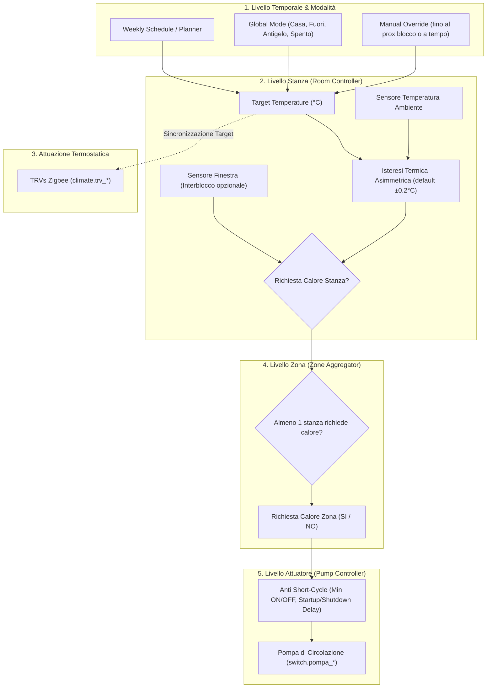

# Zoned Heating Thermostat for Home Assistant

[](https://github.com/hacs/default)
[](https://www.home-assistant.io/)
[](https://opensource.org/licenses/MIT)

**Zoned Heating Thermostat** è un'integrazione custom nativa per Home Assistant progettata specificamente per impianti di riscaldamento domestico a zone (es. caldaia/biomassa con puffer, circuiti indipendenti per Piano Terra e Piano Primo con pompe di circolazione dedicate e radiatori con valvole termostatiche Zigbee/TRV).

Sostituisce completamente la complessa e fragile ragnatela di termostati virtuali, helper `input_boolean`/`input_number`, cronotermostati separati e automazioni YAML con un **motore termico deterministico, robusto, centralizzato e dotato di un pannello di controllo dedicato a schermo intero**.

---

## 🌟 Caratteristiche Principali

- **Architettura a Pipeline Rigidamente Disaccoppiata**:
  $$\text{Schedule} \longrightarrow \text{Target} \longrightarrow \text{Room Demand} \longrightarrow \text{Zone Demand} \longrightarrow \text{Pump}$$
- **Zero-YAML & Zero-Helper**: Configurazione 100% grafica tramite wizard guidato passo-passo (Config Flow & Options Flow).
- **Pannello Dedicato Full-Width nella Sidebar**: Nessuna compressione forzata in card Lovelace strette. Una vera pagina di controllo completa (`/zoned-thermostat`) con vista gerarchica a schede larghe, cronoprogramma settimanale interattivo e timeline diagnostica in tempo reale.
- **Protezione Anti Short-Cycle per le Pompe**:
  - `min_on_time` configurabile (default 120s): impedisce spegnimenti prematuri.
  - `min_off_time` configurabile (default 120s): protegge i circolatori da ripartenze ravvicinate.
  - `startup_delay` configurabile (default 15s): attende che le TRV Zigbee inizino ad aprirsi prima di avviare il circolatore, prevenendo cavitazione o colpi d'ariete.
  - `shutdown_delay` configurabile (default 30s): post-circolazione per dissipare l'inerzia termica.
- **Supporto Multi-TRV per Stanza**: Una stanza può governare $1 \dots N$ valvole termostatiche come un'unica entità coerente.
- **Scheduler Settimanale Visivo con Preset Dinamici**:
  - Fasce orarie collegate ai preset (`Comfort`, `Eco`, `Sleep`, `Away`, `Frost`). Modificando il valore del preset, tutte le fasce collegate ereditano istantaneamente la modifica.
  - Clonazione veloce: copia giorno-giorno, copia su tutta la settimana, copia tra stanze o intere zone.
- **Override Manuali Flessibili**:
  - Modifica manuale del target fino al prossimo cambio programma, per $X$ ore o permanente.
- **Fail-Safe & Riavvio Resiliente**:
  - Sopravvive al riavvio di Home Assistant: stato delle pompe ricalcolato a freddo in modo deterministico, mai basato su memorie stale.
  - Se un sensore va offline (`unavailable`), la richiesta di calore viene disattivata in sicurezza per evitare surriscaldamenti continui.
- **Interblocchi Finestra & Presenza**: Sospensione automatica della richiesta con ritardo configurabile per evitare falsi positivi durante aperture rapide.

---

## 🧠 Come Funziona la Logica di Riscaldamento (Heating Logic)

Il motore è progettato secondo una **pipeline deterministica unidirezionale**. Ogni anello della catena ha una responsabilità singola ed è disaccoppiato da quelli a valle:



### Regola dell'Isteresi Asimmetrica
Dato il target $T_{target}$ e l'isteresi $\Delta_{hyst} = 0.2^\circ\text{C}$:
- **Avvio Riscaldamento**: la richiesta si attiva quando $T_{current} \le (T_{target} - 0.2^\circ\text{C})$
- **Stop Riscaldamento**: la richiesta si spegne quando $T_{current} \ge (T_{target} + 0.2^\circ\text{C})$
- **Deadband**: nella fascia intermedia la richiesta conserva il suo stato precedente, azzerando le continue commutazioni ON/OFF.

---

## 📦 Installazione

### Metodo 1: Tramite HACS (Consigliato)
1. Apri **HACS** nella tua istanza di Home Assistant.
2. Clicca sui tre puntini in alto a destra e seleziona **Custom repositories** (Repository personalizzati).
3. Incolla l'URL del repository: `https://github.com/alp4ca/zoned_thermostat`.
4. Seleziona la categoria **Integration** e premi **Aggiungi**.
5. Cerca **Zoned Heating Thermostat** e clicca su **Scarica**.
6. Riavvia Home Assistant.

### Metodo 2: Installazione Manuale
1. Scarica la cartella `custom_components/zoned_thermostat` da questo repository.
2. Copiala nella directory `config/custom_components/` della tua installazione di Home Assistant:
   ```
   config/
   └── custom_components/
       └── zoned_thermostat/
           ├── __init__.py
           ├── manifest.json
           ├── const.py
           ├── coordinator.py
           ├── climate.py
           ├── binary_sensor.py
           ├── sensor.py
           ├── config_flow.py
           ├── websocket.py
           ├── panel.py
           ├── frontend/
           │   └── zoned-thermostat-panel.js
           ├── core/
           └── translations/
   ```
3. Riavvia Home Assistant.

---

## 🚀 Configurazione Guidata (Config Flow)

Dopo il riavvio:
1. Vai in **Impostazioni** $\rightarrow$ **Dispositivi e Servizi** $\rightarrow$ **Aggiungi Integrazione**.
2. Cerca **Zoned Heating Thermostat**.
3. Segui il wizard in 6 passaggi:
   - **Passo 1**: Inserisci il nome dell'impianto (es. `Riscaldamento Casa`).
   - **Passo 2**: Definisci le zone (es. `Piano Terra, Piano Primo`).
   - **Passo 3**: Inserisci le stanze per ciascuna zona (es. `Sala, Cucina, Bunker`).
   - **Passo 4**: Associa a ogni stanza il sensore di temperatura ambiente primario e le relative TRV (l'integrazione suggerisce automaticamente le entità compatibili).
   - **Passo 5**: Seleziona lo switch della pompa di circolazione per ciascuna zona (`switch.pompa_pt`, `switch.pompa_p1`).
   - **Passo 6**: Verifica il riepilogo e premi Invia.

Troverai immediatamente il pannello **Riscaldamento** nella barra laterale sinistra di Home Assistant!

---

## 🖥️ Pannello Dedicato Full-Width

Il pannello registrato in sidebar (`/zoned-thermostat`) offre tre sezioni ampie e responsive:

1. **Panoramica & Zone**:
   - Stato generale dell'impianto con selettore rapido della modalità (`Casa`, `Fuori`, `Antigelo`, `Spento`).
   - Scheda ampia per ogni Zona: indicatore visivo dello stato della pompa (ON/OFF) e motivazione diagnostica esplicita (*"Pompa ON: richiesta da Cucina 20.1°C / target 21.0°C"*).
   - Card stanza con termometro ampio, regolazione del target a step di 0.5°C, preset rapidi, stato TRV con percentuale apertura e alert finestra aperta.
2. **Pianificazione Settimanale (Scheduler)**:
   - Visualizzazione a fasce orarie Lunedì - Domenica con codifica a colori per ciascun preset.
   - Pulsanti one-click per copiare il programma tra giorni, stanze o intere zone.
3. **Diagnostica & Timeline**:
   - Feed cronologico scrollabile che registra ogni decisione termica, variazione di richiesta e azione sulle pompe.

---

## 🏷️ Entità Generate in Home Assistant

L'integrazione crea una gerarchia chiara nel **Device Registry** (`System` $\rightarrow$ `Zone` $\rightarrow$ `Room`):

| Piattaforma | Entity ID Esempio | Descrizione |
| :--- | :--- | :--- |
| `climate` | `climate.riscaldamento_cucina` | Termostato logico di stanza per dashboard standard, Assist, Alexa e Google |
| `binary_sensor` | `binary_sensor.cucina_heat_demand` | Stato booleano della richiesta calore della singola stanza |
| `binary_sensor` | `binary_sensor.piano_terra_heat_demand` | Stato booleano aggregato della richiesta calore del piano |
| `binary_sensor` | `binary_sensor.riscaldamento_heat_demand` | Stato booleano della richiesta calore dell'intero edificio |
| `sensor` | `sensor.piano_terra_pump_status` | Stato operativo della pompa (`off`, `starting`, `on`, `stopping`) con spiegazione |
| `sensor` | `sensor.cucina_status` | Stato della stanza (`idle`, `heating`, `target_reached`, `window_open`, `manual_override`) |
| `sensor` | `sensor.cucina_current_temperature` | Lettura aggregata della temperatura ambiente |
| `sensor` | `sensor.cucina_target_temperature` | Target termico attualmente calcolato |
| `sensor` | `sensor.riscaldamento_global_mode` | Modalità globale attiva dell'impianto |

---

## ⚙️ Parametri Avanzati (Options Flow)

Accessibili in qualsiasi momento da **Configura** nella scheda dell'integrazione:

- **Isteresi Termica** (default: `0.2°C`, range 0.1°C – 2.0°C)
- **Tempo Minimo Pompa Accesa** (default: `120s`, range 30s – 600s)
- **Tempo Minimo Pompa Spenta** (default: `120s`, range 30s – 600s)
- **Startup Delay** (default: `15s`, attesa apertura valvole TRV)
- **Shutdown Delay** (default: `30s`, dissipazione post-circolazione)

---

## 🧪 Suite di Test Automatizzati

Il progetto include 22 test unitari automatizzati, eseguibili con il test runner standard di Python:

```bash
python3 -m unittest discover tests
```

Tra i test è presente la replica fedele dello scenario reale a due piani (**Requisito n. 42**):
- **Piano Terra**: Sala (21.5°C / 21.0°C $\rightarrow$ OFF), Cucina (20.5°C / 21.0°C $\rightarrow$ ON), Bunker (20.4°C / 20.0°C $\rightarrow$ OFF).
  - *Esito verificato*: Richiesta Piano Terra ON, Pompa PT ON (dopo startup delay 15s).
- **Piano Primo**: Camera (21.0°C / 20.0°C $\rightarrow$ OFF), Padronale (21.3°C / 21.0°C $\rightarrow$ OFF).
  - *Esito verificato*: Richiesta Piano Primo OFF, Pompa P1 OFF.
- **Transizione successiva**: Cucina raggiunge 21.2°C (soglia di arresto).
  - *Esito verificato*: Cucina OFF, Piano Terra OFF, Pompa PT OFF (dopo shutdown delay).

---

## 📄 Licenza

Rilasciato sotto licenza [MIT](LICENSE).
